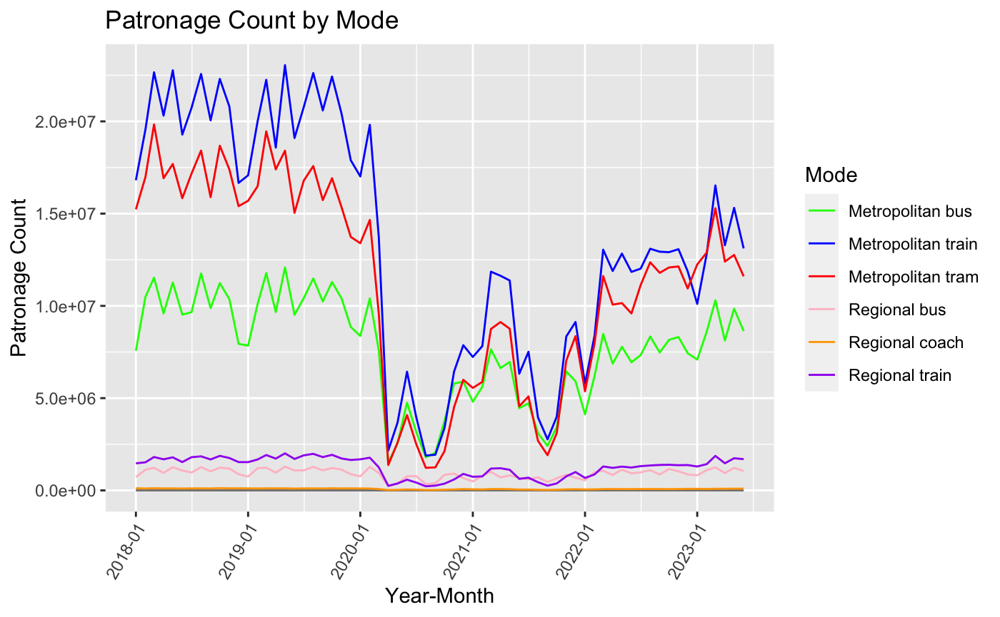
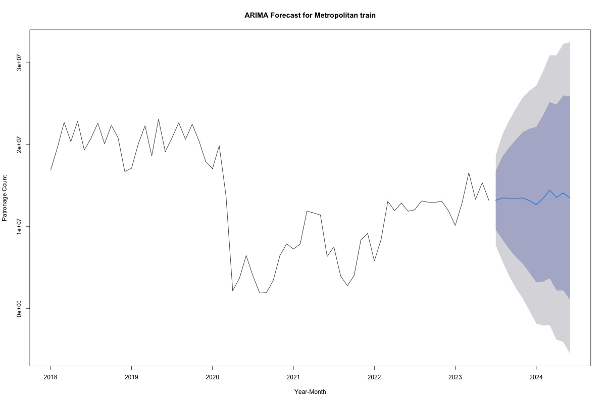

# Victorian Public Transport Patronage: Analysis and Forecasting

Exploring monthly public transport patronage across Victoria's metropolitan and regional modes, and forecasting the next 12 months with ARIMA models in R.

Built as coursework for the Master of Data Science at Monash University.

## Questions

- How does patronage differ across modes, and how variable is each one?
- How did COVID-19 affect patronage, and how has it recovered?
- What might patronage look like over the 12 months after June 2023?

## Data

[Monthly Public Transport Patronage by Mode](https://discover.data.vic.gov.au/dataset/monthly-public-transport-patronage-by-mode), Victorian Department of Transport and Planning, via data.vic.gov.au. Check the dataset page for licence terms.

- 66 monthly observations, January 2018 to June 2023
- Six modes: metropolitan train, tram and bus; regional train, coach and bus
- Monthly patronage counts per mode, with year and month columns

## Method

1. **Descriptive statistics** per mode: mean, median, variance and standard deviation
2. **Time-series plot** of monthly patronage for every mode
3. **ARIMA forecasts** for each mode using `auto.arima()` from the `forecast` package, projecting 12 months after June 2023 with prediction intervals

## Results

| Mode | Mean | Median | Std. deviation |
|---|---|---|---|
| Metropolitan train | 13,491,066 | 13,058,955 | 6,485,101 |
| Metropolitan tram | 11,220,612 | 12,108,688 | 5,500,824 |
| Metropolitan bus | 7,641,317 | 7,893,194 | 2,812,187 |
| Regional train | 1,271,306 | 1,375,851 | 533,452 |
| Regional bus | 918,951 | 947,082 | 259,240 |
| Regional coach | 79,867 | 76,857 | 29,205 |

- Metropolitan train has the highest mean and median patronage; regional coach has the lowest
- Patronage fell sharply from February 2020 with COVID-19 restrictions, dipped again in 2021, and has risen since early 2022 up to the end of the data
- Forecasts for metropolitan bus, metropolitan train and regional bus follow a fluctuating pattern. For metropolitan tram, regional coach and regional train the fitted models returned flat forecasts, meaning no usable pattern was found. Treat these as "no change" baselines, not predictions that demand will stay stable

All six forecast charts are in the `figures/` folder.

## Limitations and next steps

- The forecasts have not been validated: there is no holdout test and no error measure, so their accuracy is unknown
- Summary statistics and models include the COVID-19 period, so the means above are not typical pre-pandemic months
- Only 66 monthly points per mode, which limits what the models can learn
- Some prediction intervals extend below zero, which is impossible for patronage. A log transform would fix this
- Next steps: hold out the last 12 months and compare ARIMA with a seasonal naive baseline and ETS using RMSE or MAPE, treat COVID with an intervention variable or a post-2022 window, and add drivers such as school holidays

## Run it locally

1. Install R and RStudio, then the packages: `install.packages(c("tidyverse", "forecast"))`
2. Put `public_transport_patronage.csv` in the same folder as `patronage_analysis.Rmd`
3. Open the Rmd in RStudio and click Knit, or run the chunks one by one. The forecast charts are saved as PNG files in the working directory

## Tools

R, tidyverse, ggplot2, forecast

## Author

Lutfi Muzzaki Khairullah
